# Tarea-06-SXE-BICIS-DAMIAN
- En el ubuntu server primero crear la carpeta "bicisDamian" en la que hay que crear un repositorio con git init para poner el compose.yaml
> 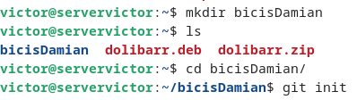
- Despues meter el ".env" dentro de gitignore como pide la tarea y poner las contraseñas y nombre de usuario
> 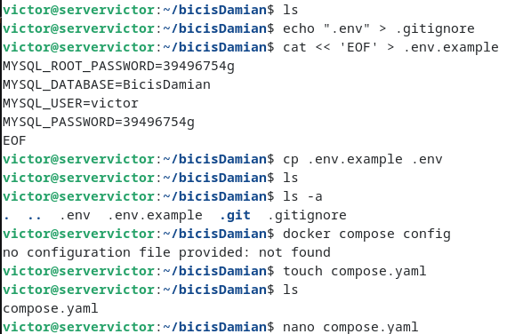
- Dentro del nano del compose.yaml poner el siguiente codigo que saque de https://hub.docker.com/r/dolibarr/dolibarr 
> 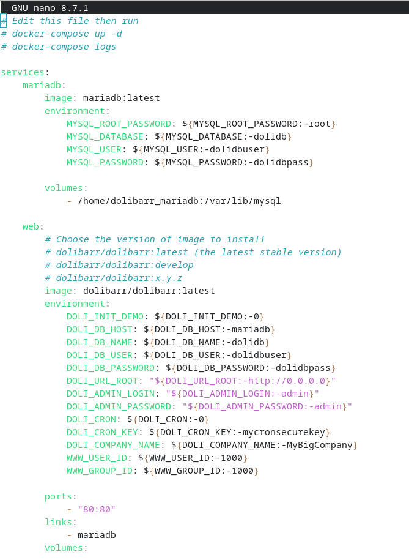

- Configuracion Dolibarr

-PASO 1

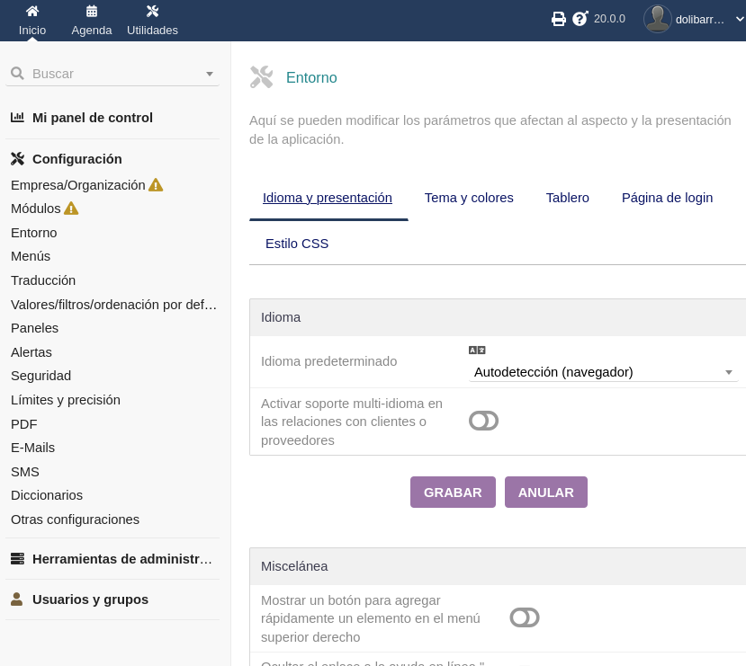

Una vez instalado Dolibarr e iniciado sesion para configurarlo vamos a Inicio - Configuracion - Modulos

Ahora vamos a activar varios Modulos

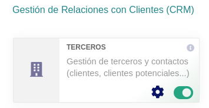

Activamos Terceros necesario para dar de alta tanto a clientes como a proveedores

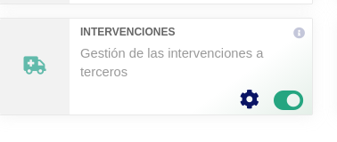

Activamos Intervenciones para saber que piezas o cambios le hemos vendido a nuestros clientes

Ahora vamos a Gestion de Relaciones con Proveedores

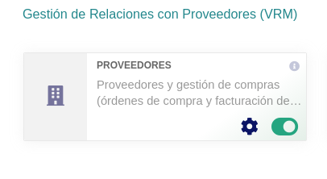

Activamos proveedores para asociar los artículos a surtidores y registrar precios de compra.

Ahora vamos a Gestion de Productos

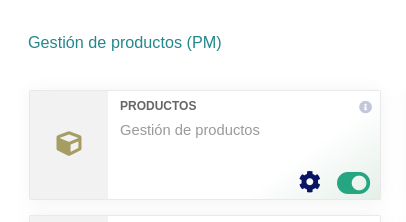

Activamos Productos para gestionar el catálogo de recambios y piezas.

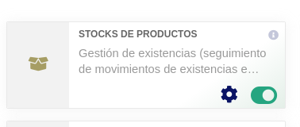

Activamos Stocks para el control de existencias en tiempo real

- PASO 2

- Ahora vamos a crear el almacen principal 
- Vamos a Productos/Servicios - Almacenes - Nuevo Almacen

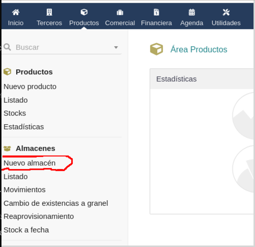

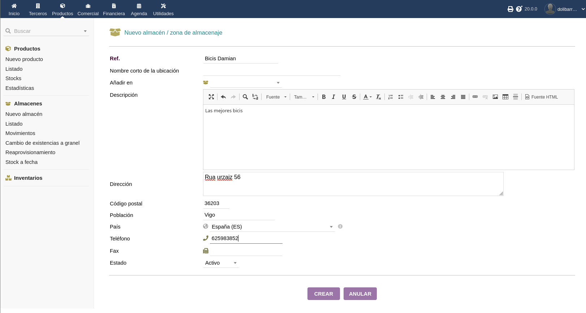

Creamos el almacen y le añadimos nombre y descripciones si lo queremos

- Ahora vamos a registrar el catalogo de recambios
- Vamos a Productos - Nuevo producto

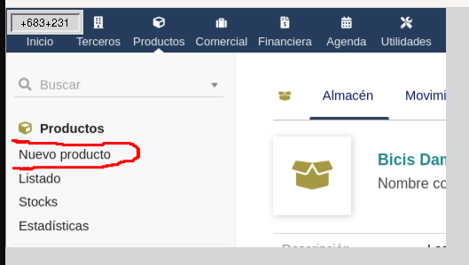

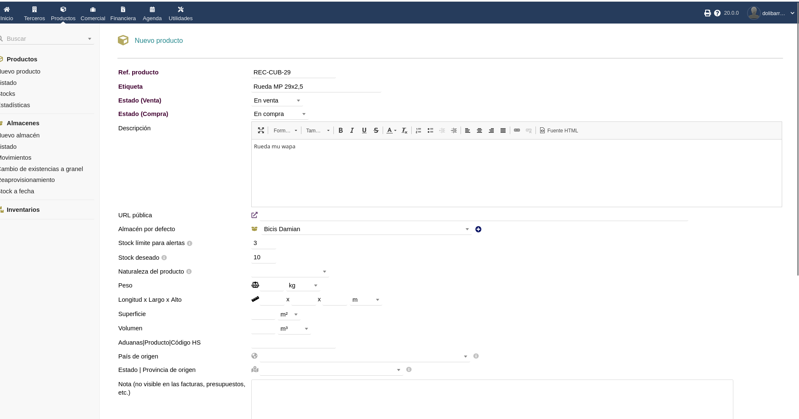

- Creamos el nuevo producto, añadimos referencia, nombre, descripcion, cuando queremos que nos alerte si llega a x unidades y cual seria el stock deseado

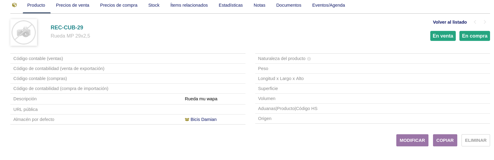

- Producto creado

- Vamos a la pestaña de arriba de Stock

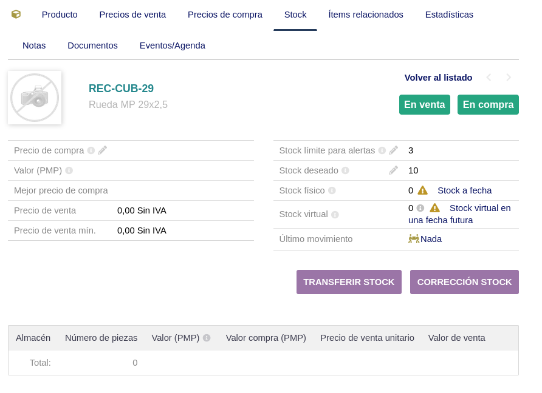

- Le damos a corregir stock y añadimos el stock del almacen 

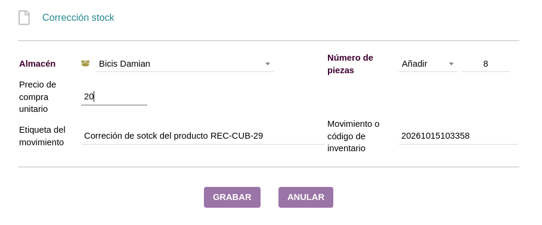

- Añadimos el stock que queremos y precio por unidad

Paso 3

- Asociar Proveedores y tarifas para elegir la opcion mas economica

- Vamos a Terceros - Nuevo Tercero

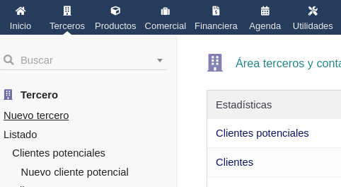

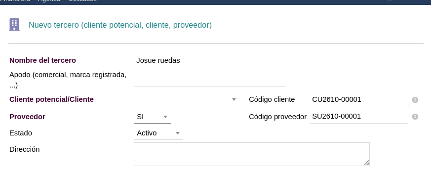

- Le ponemos nombre y marcamos la opcion proveedor

- Ahora volvemos a Productos - Lista de Productos y seleccionamos el reecambio que habiamos creado

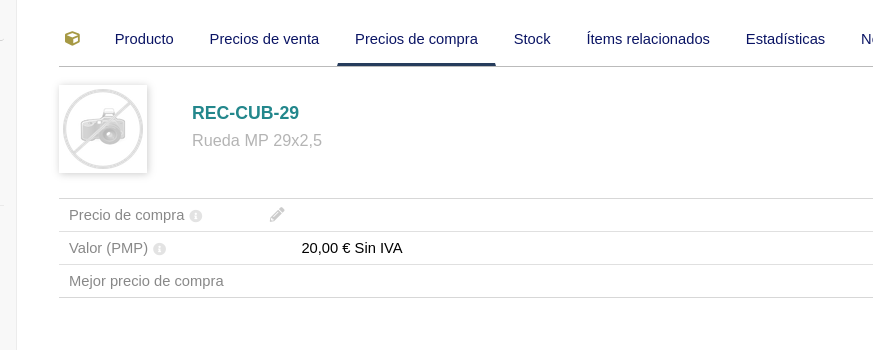

- Una vez vamos al producto le vamos a la pestaña superior de Precios de compra

- 
- 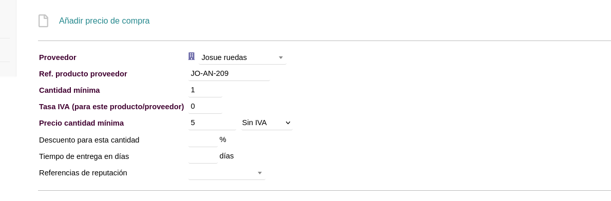

- Añadimos un proveedor con su referencia y precio de compra

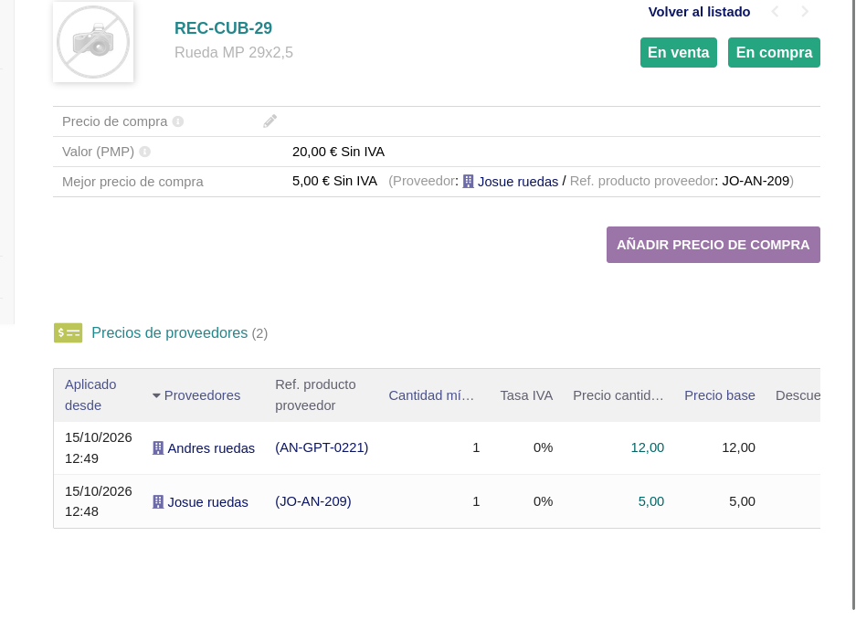

Una vez añadido podemos ver nuestros proveedores y quien tiene mejor precio de compra

Paso 4

- Ahora vamos a crear el historial de reparaciones para damian

- Volvemos a ir a terceros - nuevo tercero y creamos un cliente

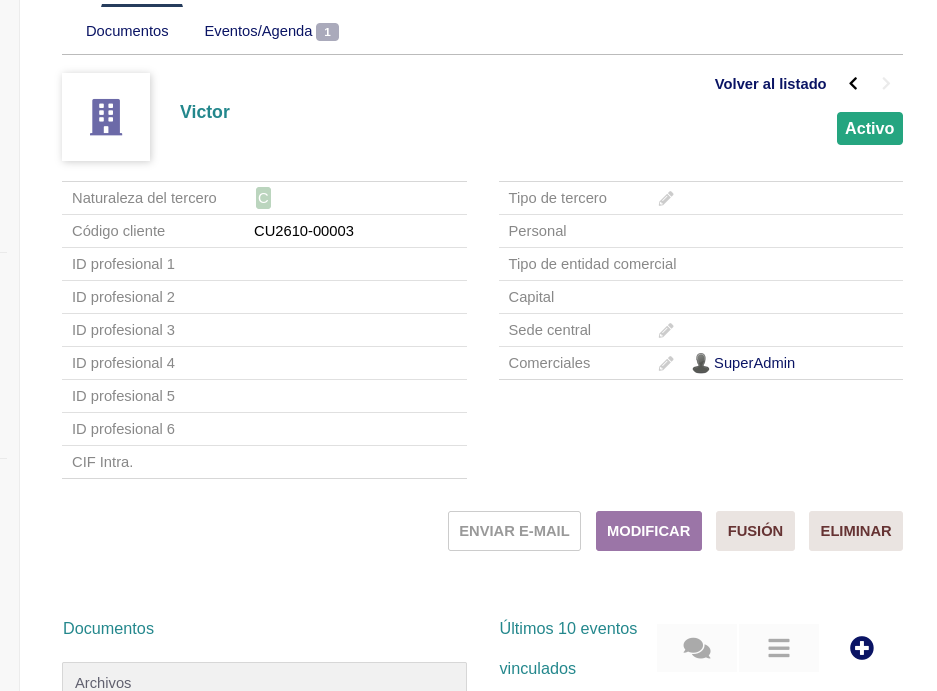

- cliente creado

- Ahora vamos a crear una ficha de taller para saber que reparacion le hemos hecho a cada cliente y que piezas usamos

- vamos a comercial - intervenciones - nueva intervencion

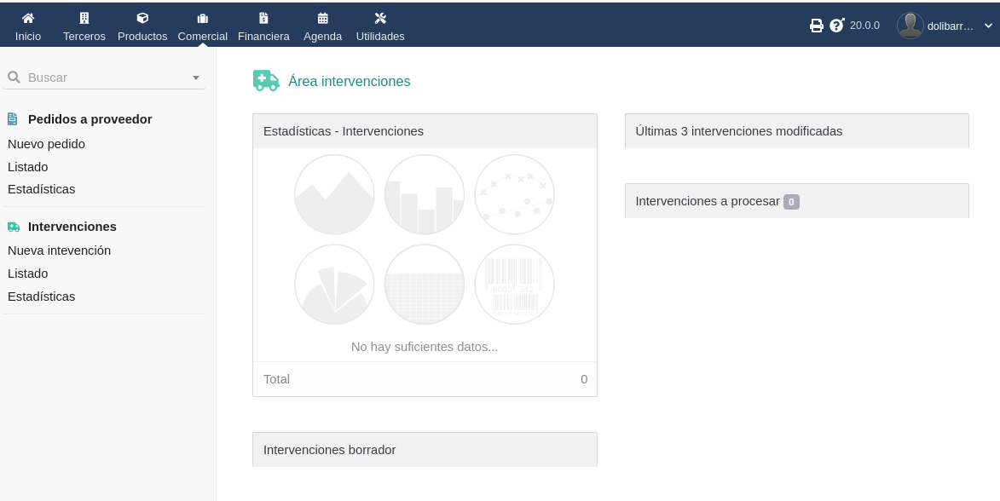

- Le damos a nueva intervencion

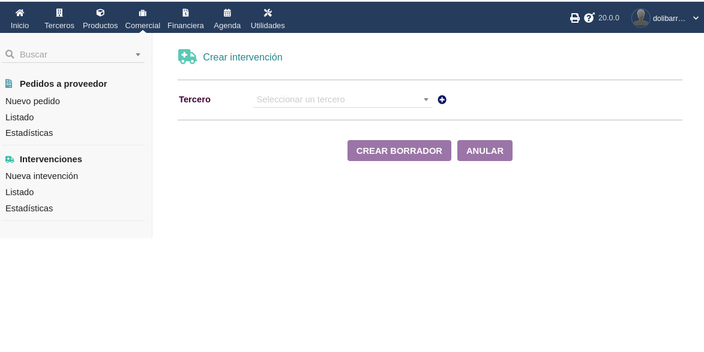

- Seleccionamos a un tercero

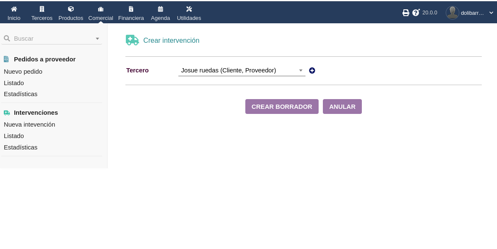

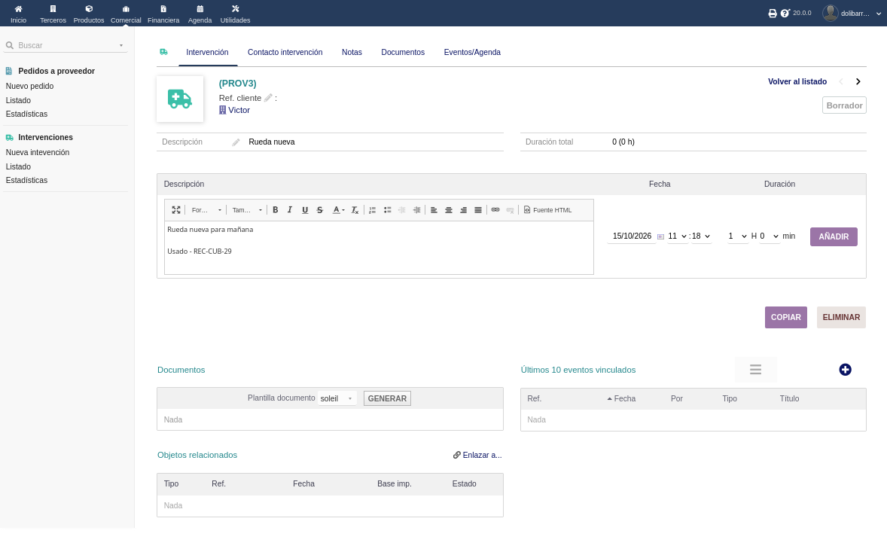

Añadimos descripcion y articulo usado 

Ahora vamos a Terceros - Lista de clientes

Seleccionamos al cliente al que le creamos la intervencion y podremos ver las intervenciones que hemos creado

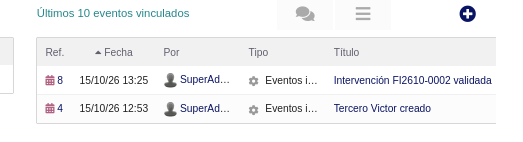

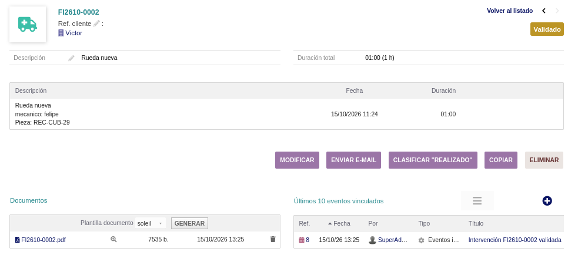

